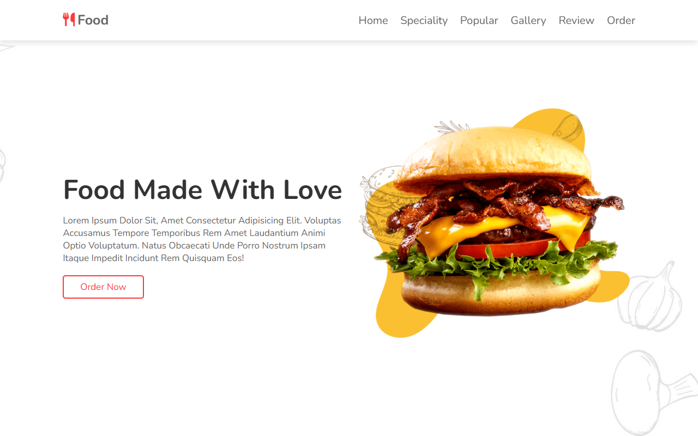
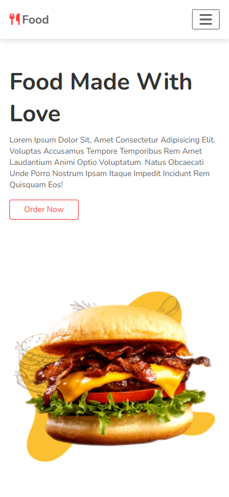

# Food Website

[](https://github.com/smadhu6364-beep/food-website/actions/workflows/pages.yml)

A responsive, single-page food and restaurant landing page with sections for specialities, popular dishes, how it works, a gallery, ordering, reviews and contact.

**Live site:** https://smadhu6364-beep.github.io/food-website/





Built by following a "complete responsive food website design" tutorial, as HTML/CSS/JavaScript practice.

## Features
- Responsive layout for mobile, tablet and desktop
- Sticky header with an accessible mobile menu toggle
- Specialities, popular dishes, steps, gallery, order form, reviews and contact sections
- Alt text on images, keyboard focus styles, and reduced-motion support
- Demo forms: nothing is sent anywhere

## Tech stack
HTML5, CSS3, vanilla JavaScript, Font Awesome 6. No build step.

## Run locally
Open `index.html` in a browser, or serve the folder:

```bash
python -m http.server 8000
```

## Deployment
Every push to `master` deploys to GitHub Pages through `.github/workflows/pages.yml`.
